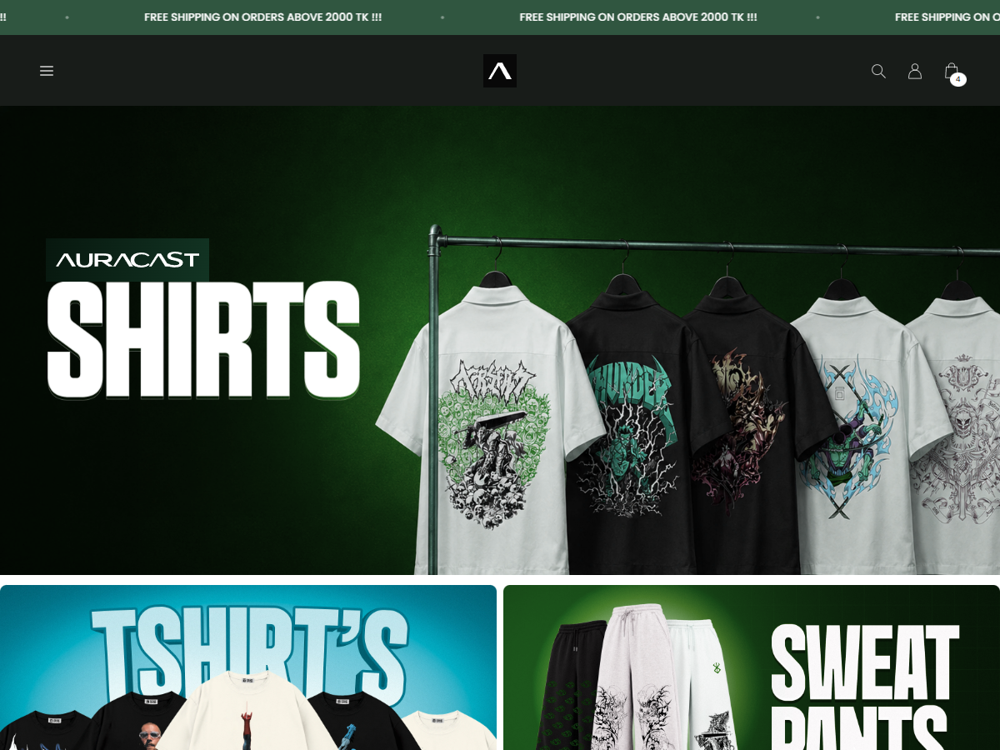

# auracast-clothing-template

An installable **AURACAST** WordPress theme for WooCommerce. Home, category, product, cart, checkout, service benefits, and footer layouts follow [Yokai](https://www.yokaiclothingbd.com/), including mobile product rails, filters, size chips, bundles, cart drawers, and checkout summaries. Auracast changes the branding and colors to forest and charcoal.



## Install

1. Install and activate **WooCommerce** on WordPress.
2. Upload [dist/auracast.zip](dist/auracast.zip) through **Appearance → Themes → Add New → Upload Theme**, and activate **Auracast**. Alternatively, upload the `auracast/` folder to `wp-content/themes/`.
3. Open **Appearance → Auracast Setup → Import demo store**. Select the **BDT / Bangladesh** option for the demo prices. Keep **classic cart and checkout** selected to use the theme's styled WooCommerce shopping pages; this replaces the content of the configured cart and checkout pages with native shortcodes.
4. Open **Appearance → Customize → Auracast** to update imagery, colors, homepage text, collections, service details, contact information, and footer. Use **Site Identity** for a replacement logo and site icon, and **Menus** for navigation.
5. Configure actual shipping, payments, taxes, policies, and email delivery in WooCommerce/WordPress before opening the store to customers.

The importer adds 30 clothing products with size variations, photographs, five clothing categories, Anime and Music & Culture collections, and the homepage, shop, cart, checkout, account, wishlist, about, contact, privacy, shipping, refund, and terms policies, and editable size guide. Repeat imports retain existing products and menus, and refresh the original demo model photos with the new Auracast set. Merchant-uploaded photos, prices, variations, and inventory are retained. The homepage and cart/checkout changes are controlled by the setup checkboxes. The importer also adds six Yokai reels as temporary content. No payment gateway is enabled by the theme.

Requires WordPress 6.6+, PHP 8.0+, and WooCommerce. No paid reference theme, page builder, or wishlist plugin is required.

## Replace demo images and products

Every campaign image can be changed from the WordPress Media Library without editing code.

| Area | Where to edit |
| --- | --- |
| Main hero | Customize → Auracast → Main hero. Replace both photographs, or select **Full campaign image** and upload one banner. |
| Graphic tees, sweatpants, music, anime, essentials banners | Customize → Auracast → Category & collection banners. Edit images, headings, labels, buttons, and links. |
| Collection slider | Customize → Auracast → Shop your world. Six editable images, titles, and destinations. |
| Style gallery | Customize → Auracast → Worn your way gallery. Five editable photographs. |
| Homepage product selections | Customize → Auracast → Homepage product sections. Automatic collections, or choose specific WooCommerce product IDs. |
| Product photos, price, inventory, sizes, colors | Products → Edit product. Use the product image, gallery, attributes, and variations controls. |
| About and newsletter popup images | Customize → Auracast → Contact & store details / Newsletter & popup. |
| Instagram posts and reels | Instagram & reels in the WordPress sidebar. Add a title, paste an Instagram URL, choose/upload a video and cover from Media Library, set the Order number, then Publish. Feed settings control the heading, profile link, speed, and visibility. |
| Size guide | Pages → Size Guide. Its content also appears in the product size guide dialog. |

Use approximately **1600 × 700** or larger for a full hero banner, **1200 × 1500** for portrait product/style photos, and **800 × 800** for collection tiles. Landscape and portrait crops adapt to mobile. All demo photos are bundled locally; no reference site connection is required when the storefront runs.

Published Instagram cards appear automatically in the moving feed. Uploaded videos autoplay muted and open with sound and playback controls when clicked. Link-only cards open the official Instagram embed; adding a video and cover lets the card play directly in the marquee. Edit, draft, trash, or reorder the cards from WordPress. This is an editable feed; new Instagram uploads are added by the store owner.

Wishlist favorites persist in the shopper's browser. Product sizes, inventory, cart, checkout, accounts, and orders use native WooCommerce. Newsletter subscriptions are saved with consent and can be exported as CSV from Auracast Setup. Newsletter campaigns require your chosen email provider. The contact form uses WordPress mail; configure your host's mail service or SMTP.

## Local preview and checks (Windows)

```powershell
npm.cmd install
powershell -NoProfile -ExecutionPolicy Bypass -File scripts/setup-local.ps1
npm.cmd run preview
```

Open **http://127.0.0.1:8088**. The setup downloads an isolated PHP, WordPress, WooCommerce, and SQLite runtime to `.local/`. It uses a separate local database and enables demo cash on delivery, 70 BDT inside-Dhaka delivery, 150 BDT outside-Dhaka delivery, and free delivery above 2,000 BDT or for four-piece bundles. Run `& .local/php/php.exe -c .local/php/php.ini scripts/apply-yokai-local.php` to update an existing local demo. Local administrator credentials are saved in `.local/admin-credentials.json`; they are excluded from Git and the theme package.

The local QA plugin suppresses outgoing mail and temporary stock reservation, whose MySQL row locks are unsupported by the SQLite adapter. Inventory validation and final stock reduction remain enabled. This plugin is excluded from the installable theme. Use standard WordPress MySQL/MariaDB hosting for the production store; live gateways, SMTP delivery, and concurrent inventory reservations require verification there.

In another terminal:

```powershell
npm.cmd run check
npx.cmd playwright install chromium
npm.cmd run test:browser
npm.cmd run test:instagram
& .local/php/php.exe -c .local/php/php.ini scripts/verify-store.php
node scripts/capture-store.mjs
npm.cmd run package
```

`BROWSER_EXECUTABLE` can point to an existing Chromium installation. Instagram checks cover moving cards, desktop/mobile proportions, playback, reduced motion, native Media Library uploads, publishing, updates, ordering, draft visibility, and feed settings. Browser checks cover homepage assets, collections, quick view, wishlist persistence, search, filters, size selection, cart quantity updates, guest COD orders, native shipping/tip totals, separate billing, policy disclosures, and viewport widths from 320 to 1440 pixels. Test output remains under `test-results/`.

## Share a temporary preview

With the local setup installed, run this from the project folder:

```powershell
npm.cmd run share
```

The helper downloads the official Windows Cloudflare tunnel client into `.local/`,
starts the local store if needed, and prints a temporary HTTPS link to send to
your client. Keep the terminal open and your PC awake with internet access.
Press **Ctrl+C** to stop sharing. A new session receives a new URL.

The sharing adapter rewrites local WordPress links and media URLs for visitors
without changing your database or local address. WordPress administration and
private database/log files are excluded from the public preview; use
`http://127.0.0.1:8088/wp-admin/` to edit the store. Demo WooCommerce settings and
the local QA mail suppression remain active.

Cloudflare Quick Tunnels are free temporary development previews, with no domain
or Cloudflare account required. See the [official Quick Tunnel guide](https://developers.cloudflare.com/tunnel/get-started/quick-tunnels/).

For a permanent site that stays online when your computer is off, install
WordPress and WooCommerce on a web host, upload `dist/auracast.zip`, import the
demo, and configure the actual store settings and domain.

## Brand and demo assets

Vector wordmarks: `auracast/assets/images/auracast-logo.svg` and `auracast-logo-white.svg`. Black-background A icon: `auracast-icon.svg` and a 512-pixel PNG. Poppins is bundled under its SIL Open Font License. Theme code is GPL-2.0-or-later.

The hero, style gallery, about page, plain tee photos, and grey hoodie model photo use seven original AI-generated portraits of adult male and female models in relaxed streetwear poses. These were created with the built-in image generation tool. The complete prompt set and saved asset filenames are recorded in [model-generation-prompts.json](auracast/assets/data/model-generation-prompts.json). Final WebP files are bundled under `auracast/assets/images/`.

The six temporary reels and their cover images come from Yokai Clothing BD, as requested for the preview. Their original Instagram links are recorded in [instagram-demo.json](auracast/assets/data/instagram-demo.json). Replace them through Instagram & reels whenever your own content is ready.

The remaining flat clothing photographs are temporary reference assets. Their source URLs are recorded in `reference/asset-sources.json`; photograph ownership remains with the respective owners. Replace demo clothing and model photos with your actual product photography when the catalog is ready.

WooCommerce integration uses public hooks and native templates, following the [classic theme developer handbook](https://developer.woocommerce.com/docs/theming/theme-development/classic-theme-developer-handbook/).

## Yokai layout update (1.1.0)

Blog links and demo posts are removed from the storefront. Policy and contact pages use the reference layout. WordPress/WooCommerce continue to process cart, accounts, payment methods, inventory, and orders. Checkout accepts email or mobile contact, optional tips, separate billing, discount codes, and optional browser-saved delivery details. Marketing consent is stored on the order; connect your email provider for campaigns.

Bundle prices are calculated from native product prices on every cart update: two pieces 5%, three 10%, four 12%, and five or more 15%. Configure actual delivery and payment methods in WooCommerce; the theme gives configured free-shipping methods precedence and permits four-piece bundles to qualify.

Campaign artwork and service icons are bundled and listed in `auracast/assets/data/campaign-sources.json`; original ownership remains with Yokai and the respective artists. Banner colors shift through CSS; all campaign images remain replaceable in the Customizer. Configure the footer social links and store contact information for your own brand. Poppins weight 800 is bundled under the existing OFL.
